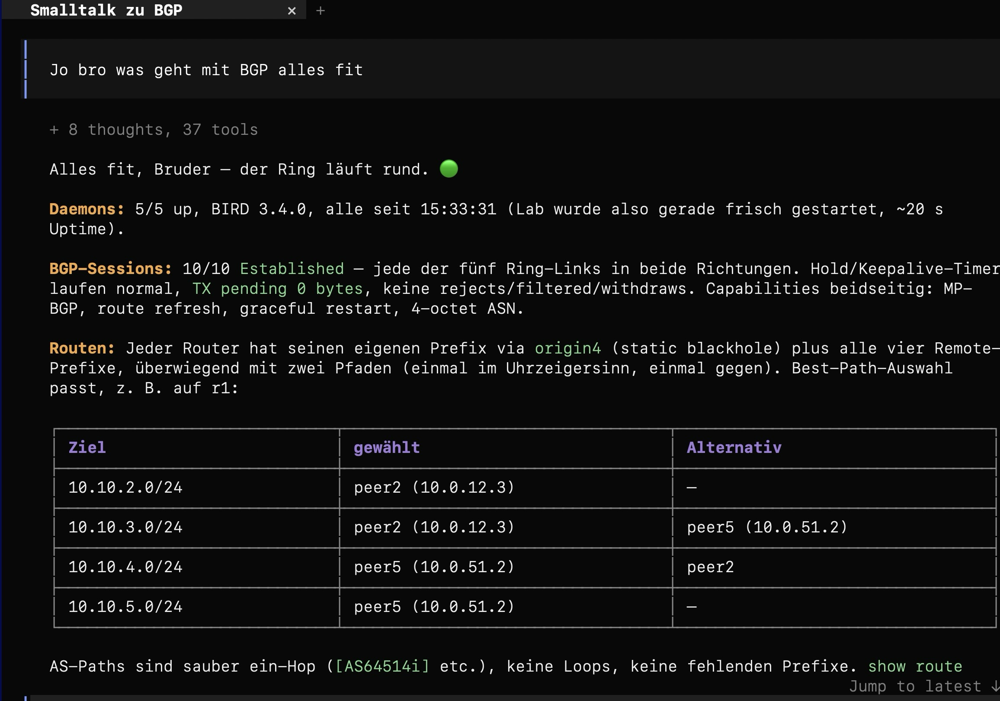

# BIRD-MCP

[](https://github.com/rmoriz/bird-mcp/actions/workflows/ci.yml)
[](https://github.com/rmoriz/bird-mcp/releases)

BIRD-MCP is an MCP (Model Context Protocol) server for the
[BIRD Internet Routing Daemon](https://bird.nic.cz/). It lets an agent inspect a
running BIRD instance — protocols, BGP sessions, routes, interfaces — and, only
when explicitly allowed, change its configuration. The crate and binary are
called `bird-mcp`.

The parsers are written against the CLI output of **BIRD 3.4.0** (the checkout in
`bird/` is pinned to `v3.4.0`). Commands are sent to `birdc`, either on this machine
or over ssh to the router.

> **Try it on a real topology:** [`tests/compose/`](tests/compose/README.md) starts
> five BIRD routers (one per AS) with a traffic generator and an OpenCode container
> wired to all five through this MCP server — including blackholing a prefix and
> watching the traffic stop.

<p align="center">
  
</p>

## Tools

| Tool | What it does | Writes |
| --- | --- | --- |
| `bird_routers` | List configured routers, optionally probe each one | no |
| `bird_status` | Version, router ID, hostname, uptime, last reconfiguration, daemon state | no |
| `bird_protocols` | Protocol instances; `details=true` adds BGP session state, timers and channel counters | no |
| `bird_routes` | Parsed routes: prefix, destination type, protocol, preference, next hops, attributes; exact/`for`/`in` lookups, table and protocol filters, `count_only` statistics | no |
| `bird_routes_edit` | Add, remove or list static routes in the managed `routes_file` and reload BIRD; `add` with just a prefix makes a blackhole route | yes |
| `bird_interfaces` | Interfaces with state, MTU, flags, addresses (or a one-line summary) | no |
| `bird_fleet` | One read-only check (status, protocols, routes, interfaces) across many routers in parallel | no |
| `bird_show` | Any other read-only command, e.g. `show bfd sessions`, `show ospf neighbors`, `show symbols`, `show memory` | no |
| `bird_config_read` | Read the configuration file from the router | no |
| `bird_configure` | `check`, `apply`, `undo`, `confirm` | check: no, rest: yes |
| `bird_protocol_control` | `enable`, `disable`, `restart`, `reload [in\|out]` | yes |
| `bird_docs_search` | Search the bundled BIRD documentation | no |
| `bird_docs_section` | Read a documented feature by label, e.g. `cli-show-route` | no |
| `bird_docs_read` | Read a line range from `bird.sgml`, `bird.conf.example`, ... | no |

Every tool answers with pretty-printed JSON (except `bird_show`, which returns the
CLI text). Parsed responses keep the unparsed output when you pass `raw: true`.

With many routers, `bird_fleet { "check": "status" }` queries all of them (or a
`routers` subset) in parallel and returns per-router results plus `elapsed_ms`;
`concurrency` bounds the fan-out (default 8). `bird_routers { "probe": true }`
probes in parallel as well.

## Requirements

- Rust 1.88 or newer to build.
- `birdc` reachable on the machine running BIRD (local transport) or via ssh.
- Key-based ssh for remote routers; the transport uses `BatchMode=yes`, so it never
  prompts for a password.

## Install

Prebuilt binaries are attached to every release. `latest` is rebuilt on each
push to `main`, so these links always point at the current build:

| Platform | Download |
| --- | --- |
| macOS, Apple Silicon | [bird-mcp-aarch64-apple-darwin.tar.gz](https://github.com/rmoriz/bird-mcp/releases/latest/download/bird-mcp-aarch64-apple-darwin.tar.gz) |
| macOS, Intel | [bird-mcp-x86_64-apple-darwin.tar.gz](https://github.com/rmoriz/bird-mcp/releases/latest/download/bird-mcp-x86_64-apple-darwin.tar.gz) |
| Linux, arm64 | [bird-mcp-aarch64-unknown-linux-gnu.tar.gz](https://github.com/rmoriz/bird-mcp/releases/latest/download/bird-mcp-aarch64-unknown-linux-gnu.tar.gz) |
| Linux, x86_64 | [bird-mcp-x86_64-unknown-linux-gnu.tar.gz](https://github.com/rmoriz/bird-mcp/releases/latest/download/bird-mcp-x86_64-unknown-linux-gnu.tar.gz) |
| Checksums | [SHA256SUMS](https://github.com/rmoriz/bird-mcp/releases/latest/download/SHA256SUMS) |

Each archive contains the binary, README, LICENSE and changelog. Fixed versions
are published from `v*` tags on the [releases page](https://github.com/rmoriz/bird-mcp/releases).

```sh
tar -xzf bird-mcp-aarch64-apple-darwin.tar.gz
sudo install bird-mcp-aarch64-apple-darwin/bird-mcp /usr/local/bin/
```

### Build from source

```sh
cargo build --release
# binary: target/release/bird-mcp

# or install it into ~/.cargo/bin
cargo install --path .
```

## Configure

With no configuration at all, the server talks to a local `birdc` (using its
compiled-in control socket) and is read-only. That is often enough on the router
itself.

For anything else, write `~/.config/bird-mcp/config.toml`:

```toml
# Where the BIRD source doc directory lives, for the bird_docs_* tools.
docs_dir = "/Users/me/src/bird/doc"

[[routers]]
name = "edge1"
transport = "ssh"
host = "router1.lab.example.net"
user = "root"
socket = "/run/bird/bird.ctl"
config_file = "/etc/bird/bird.conf"
read_only = true

[[routers]]
name = "lab"
transport = "local"
birdc = "/usr/local/sbin/birdc"
socket = "/run/bird/bird.ctl"
read_only = false
timeout_secs = 30
```

`BIRD_MCP_ROUTERS` overrides the file with a JSON array of the same objects:

```sh
export BIRD_MCP_ROUTERS='[
  {"name": "r1", "transport": "ssh", "host": "r1.example.net", "read_only": true},
  {"name": "lab", "birdc": "/opt/bird/sbin/birdc"}
]'
```

### Router fields

| Field | Default | Meaning |
| --- | --- | --- |
| `name` | `local` / `routerN` | Router name used by the `router` argument |
| `transport` | `local`, or `ssh` when `host` is set | `local` or `ssh` |
| `host` | – | ssh host |
| `user` | – | ssh user |
| `port` | 22 | ssh port |
| `birdc` | `birdc` | birdc binary on the machine that runs BIRD |
| `socket` | birdc default | Control socket (`birdc -s`) |
| `config_file` | `/etc/bird/bird.conf` | File read by `bird_config_read` |
| `routes_file` | – | Include file managed by `bird_routes_edit` |
| `routes_preference` | 200 | Preference of the managed static protocols |
| `read_only` | `true` | Must be `false` to allow writes |
| `timeout_secs` | 20 | Per-command timeout |

### Environment

| Variable | Meaning |
| --- | --- |
| `BIRD_MCP_ROUTERS` | JSON array of routers; overrides the config file |
| `BIRD_MCP_CONFIG` | Config file path (must exist) |
| `BIRD_MCP_DOCS_DIR` | BIRD `doc/` directory for the documentation tools |
| `BIRD_MCP_TIMEOUT` | Default timeout in seconds (1–300) |
| `BIRD_MCP_BIRDC` | birdc binary for routers without an explicit `birdc` |
| `BIRD_MCP_SOCKET` | Socket for the default local router |
| `BIRD_MCP_CONFIG_FILE` | Config file path for routers without an explicit one |
| `BIRD_MCP_ROUTES_FILE` | Managed route include file for routers without an explicit one |
| `BIRD_MCP_ROUTES_PREFERENCE` | Preference for the managed static protocols (default 200) |
| `BIRD_MCP_SSH_BIN` | ssh binary (default `ssh`) |

`bird-mcp --check` validates the configuration and prints the routers.

## MCP client

Generic stdio configuration:

```json
{
  "mcpServers": {
    "bird": {
      "command": "/Users/me/.cargo/bin/bird-mcp",
      "env": {
        "BIRD_MCP_CONFIG": "/Users/me/.config/bird-mcp/config.toml"
      }
    }
  }
}
```

OpenCode (`opencode.json`):

```json
{
  "mcp": {
    "bird": {
      "type": "local",
      "command": ["bird-mcp"],
      "environment": {
        "BIRD_MCP_CONFIG": "/Users/me/.config/bird-mcp/config.toml"
      }
    }
  }
}
```

The server only speaks MCP over stdio; it does not open a network port.

## Read-only by default

Every router is read-only unless its configuration says `read_only = false`.
In read-only mode `bird_configure` only allows `mode = "check"` (which parses a
config file without applying it), and `bird_protocol_control` refuses every
action. `bird_show` accepts only commands whose first word is `show`.

Writes are never assembled from caller-supplied shell text: protocol targets,
tables and config paths are validated against a small character set, and the
command is passed to birdc as one argument (locally) or as a quoted word
(over ssh).

## Changing routes and blackholing

BIRD has no runtime command to add or remove a route: a route change is a
configuration change. `bird_routes_edit` manages a small include file and
reloads BIRD for you.

Include the file once in `bird.conf`:

```bird
include "/etc/bird/bird-mcp.conf";
```

and point the router at it:

```toml
[[routers]]
name = "edge1"
transport = "ssh"
host = "router1.lab.example.net"
read_only = false
routes_file = "/etc/bird/bird-mcp.conf"
```

The tool renders that file as two static protocols, `bird_mcp_static4` and
`bird_mcp_static6`, so IPv4 and IPv6 routes can share it:

```bird
protocol static bird_mcp_static4 {
  ipv4 {
    preference 200;
  };
  route 203.0.113.0/24 blackhole;
  route 198.51.100.0/24 via 192.0.2.1 dev eth0;
}
```

Typical calls:

```text
bird_routes_edit { action: "add", prefix: "203.0.113.0/24" }         # blackhole
bird_routes_edit { action: "add", prefix: "198.51.100.0/24",
                   kind: "via", via: "192.0.2.1", dev: "eth0" }
bird_routes_edit { action: "add", prefix: "2001:db8:bad::/48",
                   kind: "unreachable" }
bird_routes_edit { action: "remove", prefix: "203.0.113.0/24" }
bird_routes_edit { action: "list" }
```

`kind` is `blackhole` (default), `unreachable`, `prohibit` or `via`. An add or
remove writes the file, runs `configure check`, then `configure`; a failed check
restores the previous file and leaves BIRD untouched. `apply: false` only stages
the file, `dry_run: true` returns the new file without writing. After applying,
the tool looks the prefix up in `show route` and reports whether the managed
protocol route is actually present.

What a blackhole route does downstream is policy, not something the server can
guess: export `bird_mcp_static4`/`bird_mcp_static6` from the kernel protocol to
drop packets locally, or from BGP with the community and next hop your upstream
expects for RTBH (for example `bgp_community.add((65535, 666));` and
`gw = 192.0.2.1;` in the export filter).

## Documentation tools

`bird_docs_search`, `bird_docs_section` and `bird_docs_read` read the SGML/Markdown
documentation that ships with a BIRD source checkout. Resolution order:

1. `BIRD_MCP_DOCS_DIR` (or `docs_dir` in the config file),
2. `./bird/doc`, `./doc`,
3. the same relative to the working directory's parent and to the executable.

Ask for a label such as `cli-show-route`, `cli-configure-check`, `protocols-bgp`
or `filters`; `bird_docs_search` finds the labels and line numbers.

## Tests

```sh
cargo test            # parsers, config, transport, docs, MCP stdio end-to-end
cargo clippy --all-targets -- -D warnings
```

The fixtures in `tests/fixtures/` are real output from a two-router BIRD 3.4.0
lab. `tests/docker/` contains the configs and a script that rebuilds the lab and
recaptures them. `tests/live_docker.rs` is an ignored end-to-end test that talks
to the running lab, including the write path:

```sh
cargo test --test live_docker -- --ignored
```

### Five-AS lab with OpenCode

`tests/compose/` is a manual test environment: five BIRD routers (one per AS) in
a ring, a customer host per AS, a traffic generator (ping, HTTP, iperf3) and a
Debian container running OpenCode with BIRD-MCP configured against all five
routers. It needs the `bird/` checkout and Docker Compose:

```sh
cd tests/compose
docker compose up -d --build
docker compose logs -f sim
docker compose exec -it opencode opencode
```

See `tests/compose/README.md` for the topology, the blackhole exercise and the
caveats. Nothing in this lab is production-safe: every router is write-enabled
and the agent container shares the control sockets.

## Security notes

- Access to the BIRD control socket is equivalent to full BIRD control. If the
  socket is shared, use a restricted socket (`cli "birdctl" { restrict; };`) for
  read-only use and point a read-only router at it.
- The server does not implement authentication or remote HTTP transports. Run it
  locally, over stdio, as the user that may talk to `birdc`.
- `configure apply` reloads BIRD's configuration. Use `timeout_secs` to let BIRD
  revert automatically if the new configuration cuts your access, then
  `mode = "confirm"` when it works.
- Not affiliated with the BIRD project or CZ.NIC.

## AI usage

Substantial parts of this repository — the Rust code, tests, fixture workflow,
documentation and CI — were written with AI assistance (an LLM coding agent in
the OpenCode harness) under human direction and review. Behavior is pinned by
tests against real BIRD 3.4.0 output, and releases are built by CI.

Treat generated code and configuration changes like any other contribution. With
`read_only = false` and a `routes_file`, this server can change routing state on
a live router.

## License

MIT

---

*If you like this AI generated slop, consider sponsoring me a RIPE ASN and IPv6 PI? 🥺👉👈*
