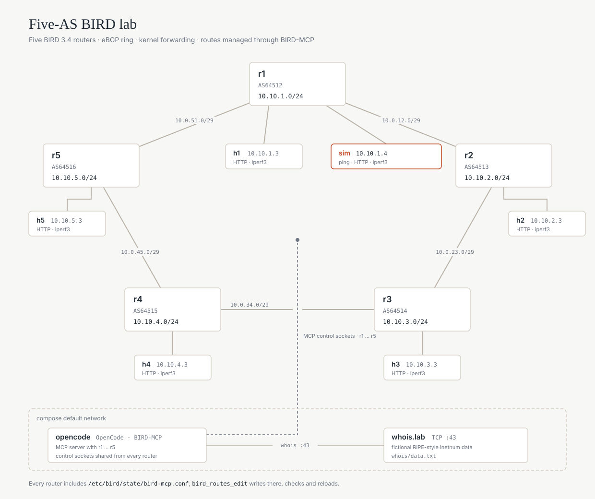

# Five-AS BIRD lab with traffic and an OpenCode MCP client

The point of this setup is the `opencode` container: it has `birdc`, `bird-mcp`
and OpenCode, and reaches **all five routers** through one MCP server. The
routers, hosts and traffic generator exist so the agent has something real to
inspect and change.

## Quick start

```sh
cd tests/compose
docker compose up -d --build                    # first build takes ~3 minutes
docker compose exec -it opencode opencode auth login   # once per provider
docker compose exec -it opencode opencode
```

`opencode mcp list` should show `✓ bird connected`. The workdir contains an
`AGENTS.md` describing the lab; the MCP server is called `bird` and its tools
take `router: "r1"` … `"r5"`.

The default model is `opencode-go/deepseek-v4.1-flash` (set in
`agent/opencode.json`). Change it with `/models` in the TUI or by editing that
file and recreating the container. Without a model in the config, OpenCode picks
its own default (currently a free `hungerg-free` model), not your Go plan.

Credentials (including OpenCode Go) live in `/root/.local/share/opencode` inside
the container, which is the named volume `opencode_auth`. OpenCode v2 stores
them in the SQLite database `opencode.db` (table `credential`; legacy
`auth.json` from v1 is imported on first start), so they survive container
recreation. `docker compose down` keeps the volume; `docker compose down -v`
deletes it.

### Use your host OpenCode Go login

Pick one:

```sh
# 1. API key: put OPENCODE_API_KEY=... into tests/compose/.env
cp .env.example .env && $EDITOR .env

# 2. Extract the host's OpenCode Go key into .env and recreate the container
./use-host-login.sh

# 3. Reuse the whole host data directory live
OPENCODE_DATA_DIR=$HOME/.local/share/opencode docker compose up -d --force-recreate opencode
```

After option 1, recreate the container (`docker compose up -d --force-recreate
opencode`); option 2 does that itself. `opencode auth list` inside the container
should list OpenCode Go. Option 3 shares the SQLite database with the host: do
not run host OpenCode and the container at the same time, and expect the
(large) database to be accessed through the mount.

## What to try in OpenCode

Just ask in natural language; the agent picks the MCP tools.

| Prompt | What happens |
| --- | --- |
| "Show status and all BGP sessions on the five routers." | `bird_fleet` status + `bird_fleet` protocols with `details=true` |
| "Which path does r1 use for 10.10.4.0/24, and why?" | `bird_routes` with `match_mode: "for"`, `verbose: true` incl. AS path |
| "Blackhole 10.10.3.0/24 on r1." | `bird_routes_edit` add → config check → reload → verification |
| "Remove that blackhole again." | `bird_routes_edit` remove |
| "Restart peer3 on r2." | `bird_protocol_control` restart |
| "Check the config on r5 without applying it." | `bird_configure` with `mode: "check"` |
| "What does the BIRD documentation say about next hop self?" | `bird_docs_search` / `bird_docs_section` |

The same calls as raw arguments, if you want to see what the agent sends:

```jsonc
bird_routers          { "probe": true }
bird_status           { "router": "r3" }
bird_protocols        { "router": "r2", "details": true }
bird_routes           { "router": "r1", "prefix": "10.10.4.0/24", "match_mode": "for", "verbose": true }
bird_routes_edit      { "router": "r1", "action": "add", "prefix": "10.10.3.0/24" }
bird_routes_edit      { "router": "r1", "action": "remove", "prefix": "10.10.3.0/24" }
bird_protocol_control { "router": "r2", "action": "restart", "target": "peer3" }
bird_configure        { "router": "r5", "mode": "check" }
bird_show             { "router": "r4", "command": "show ospf neighbors" }
bird_docs_search      { "query": "next hop self" }
```

### Watch the blackhole land

```sh
docker compose logs -f sim
```

Before: `dst=10.10.3.3 ping=up http=200`. After the blackhole on r1:
`ping=DOWN http=000` within a few seconds, while every other destination stays
up. Removing it restores traffic. The sim also prints an iperf3 sample to
AS64515 once a minute.

## Topology

<p align="center">
  
</p>

Each router originates its customer prefix (10.10.N.0/24), exports static and
BGP routes over eBGP and installs BGP routes in the kernel, so traffic really
traverses the ring. Hosts are `10.10.N.3` behind router N; `sim` is
`10.10.1.4` behind r1.

### MCP wiring

One MCP server (`bird`) exposes all five routers through the `router` argument.
Every router is write-enabled and already includes the file that
`bird_routes_edit` manages:

| MCP router | AS | BIRD include | routes_file seen by the agent |
| --- | --- | --- | --- |
| `r1` | 64512 | `/etc/bird/state/bird-mcp.conf` | `/state/r1/bird-mcp.conf` |
| `r2` | 64513 | `/etc/bird/state/bird-mcp.conf` | `/state/r2/bird-mcp.conf` |
| `r3` | 64514 | `/etc/bird/state/bird-mcp.conf` | `/state/r3/bird-mcp.conf` |
| `r4` | 64515 | `/etc/bird/state/bird-mcp.conf` | `/state/r4/bird-mcp.conf` |
| `r5` | 64516 | `/etc/bird/state/bird-mcp.conf` | `/state/r5/bird-mcp.conf` |

Add and remove were exercised on each of the five routers.

## Optional: shell checks without OpenCode

Only needed for debugging the lab itself.

```sh
docker compose exec opencode bird-mcp --check
docker compose exec opencode birdc -s /run/bird/r3/bird.ctl show protocols
docker compose exec h1 curl -s http://10.10.5.3/
```

## Stop

```sh
docker compose down          # keeps the opencode_auth volume with your logins
# docker compose down -v    # also deletes OpenCode credentials and socket volumes
rm -rf state
```

## Notes

- Lab, not a deployment guide: all routers are write-enabled, routes are not
  filtered, and the agent container shares the control sockets.
- Routers need `NET_ADMIN` for the kernel protocol and forwarding; hosts need it
  to point their default route at the router.
- The BIRD checkout in `../../bird` (branch `v3.4`) is required for the builds.
